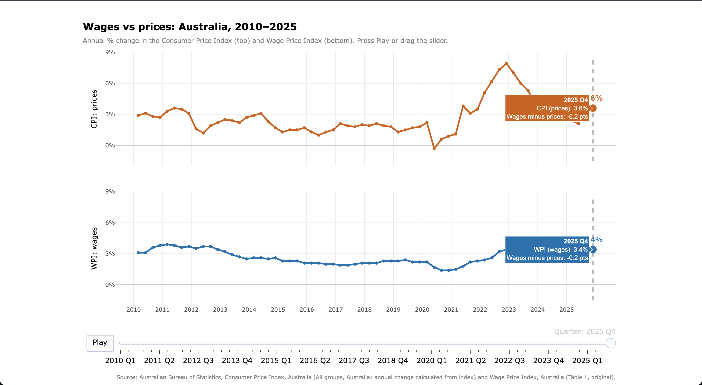
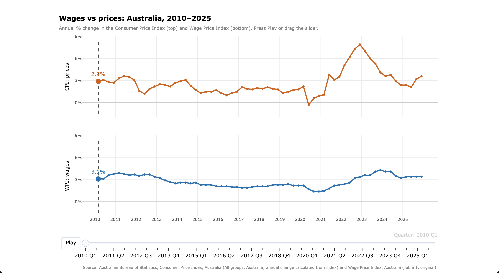

# Module 10: Multiplot It!

*Published 27 October 2026*

## 1. Ideation
For module 10, I’ve been tasked with multiplotting a visualisation and including basic interactive features. I was going to create a multiplot relating to the topic of cars and automobiles, but I couldn’t find a data source that contained the information I needed to do so, if I did, I couldn’t trace the exact origins of the raw data used. Instead, I wanted to make a multiplot display using the data I used from my economics elective where we explored Consumer Price Indexes (CPI) from the Australian Bureau of Statistics (ABS) to find relationships with inflation and rising cost of living. I had the idea of exploring the historic year-on-year change of CPI alongside the Wage Price Index (WPI). Time and time again, we see many headlines on social media and news sources talking about the cost of living crisis and how essentials are becoming increasingly affordable such as groceries, gas, etc. I wanted to see to what extent is that true based on historic real-world data by creating a time series chart exploring side by side the progression of the year-on-year percentage change between CPI and WPI starting from 2010-2025, which covers 16 years of data.   

## 2. Creation process

Similarly to module 9, I used plotly and shiny to introduce basic interactive features to the multiplot. User can either press the Play button to automatically progress through each quarter or manually hover over the specific periods between 2010 and 2025. As the selected quarter changes, both charts will update simultaneously, displaying the corresponding CPI and WPI figures and the difference between them. This allows users to observe how inflation and wage growth has evolved over time in Australia and compare their movements across the same period. I think my approach was effective because it give users control over how they explore the data rather than presenting all the info as one static visualisation.   

## Multiplotted time-series of CPI vs WPI 
 
 

This is a screenshot of the native Shiny URL on my computer, the embedded link is: https://km9zqt-norinn-keo.shinyapps.io/cpi_app/ 

## 3. Interesting insights
One of the most interesting observations of my visualisation was the significant spike in CPI during 2022 and 2023, where annual inflation peaked at around 8%. However, the wage growth stayed at the same rate/didn't increase at all. This creates a very noticeable gap between rising prices and wages, something we’ve probably all felt in our day-to-day lives. The cost of living can increase faster than people’s earnings, which reduces their purchasing power and makes it harder for them to afford essentials or just leisure in general; an issue that many households in Australia currently face. Another interesting observation was the relatively smaller gap between the two indexes toward the end of 2025, with CPI at 3.6% and WPI at 3.4%, although this suggest that wage growth is beginning to catch up with inflation, prices were still increasingly slightly faster than wages.  

## Reflection

Overall, this module allowed me to explore how multiplotting and interactive features can be used to communicate a more meaningful story through data. Using ggplot2, htmlwidgets, Plotly, and Shiny, I was able to transform two separate economic indicators into an interactive visualisation that makes historical comparisons digestible for the users. More importantly, I learned visualisations don't just simply display data, but they also provide users the opportunity to explore patterns, identify relationships and draw their own conclusions. If I were to improve this visualisation further, I would introduce additional economic indicators such as household disposable income to provide a more comprehensive understanding of changes in living standards.  
