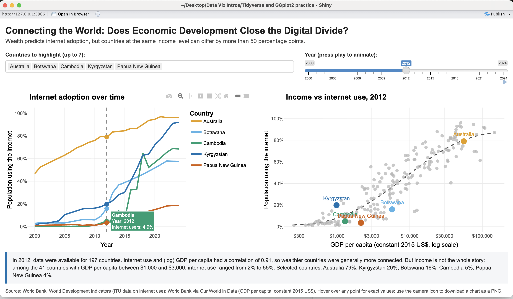

# Module 9: Make It Interactive!

*Published 27 October 2026*

## 1. Ideation
For this portfolio exercise, I developed an interactive multiplot visualisation exploring the relationship between internet access and economic development. Using R, ggplot2 and plotly, I combined a line chart showing changes in internet usage over time with a scatter plot comparing internet access against GDP per capita. My aim was to investigate whether economic development alone explains differences in global internet connectivity.   

## 2. Creation process

One of the main challenges was preparing and combining data from different sources. My original approach of importing datasets directly from Our World in Data (OWID) URLs failed, so I switched to locally downloading the CSV files. The internet usage data was reused from previous module 8 and 9. I had to reshape the data using pivot_longer() and match countries using ISO codes rather than names to avoid mismatches. This experience taught me to inspect datasets thoroughly before writing code rather than assuming their structure. I also learned that seemingly minor technical details, such as handling missing years and distinguishing countries from regional aggregates, can significantly affect the accuracy of a visualisation. 

More importantly, I realised that a technically functional visualisation does not necessarily communicate the right message. My initial version emphasised wealthier countries and supported a relatively simple conclusion that richer countries are more connected. However, after comparing countries against the trendline for their income levels, I discovered substantial differences between countries with similar GDP per capita. For example, Kyrgyzstan had approximately 92% internet usage, compared with around 19% in Papua New Guinea. I revised my selected countries, titels, summary to emphasise these differences rather than simply reinforce the overall relationship. This was a significant learning moment because it showed me that selecting which observations to highlight is itself an analytical decision that can influence how audience interpret evidence and what narratives they can take from it.  

I also improved the visualisations usability through linked plots, a year slider, animated playback, country selection, hover tooltips and a high resolution PNG export. Using a colour-blind-friendly palette from Okabe-Ito, direct labels and a plain-language summary helped make the findings easier to understand. However, I recognise that interactive elements are not fully accessible across all keyboard and screen-reader users, so further accessibility testing a static alternative would improve the final product.  

## Multiplotted internet choropleth + line graph interactive visualisation 
 

This is a screenshot of the native Shiny URL on my computer, the embedded link can be provided via email. 

The findings challenged my earlier assumptions that greater economic development would consistently narrow the digital divide. What seemed obvious at a glance revealed deeper nuances; although internet usage was strongly associated with income, countries at similar income levels increasingly displayed different connectivity problems. Nevertheless, I had to remain cautious about interpreting these patterns. Country-level averages cannot explain inequalities within countries, and potential explanations involving infrastructure, government policy or mobile data affordability remain hypotheses rather than proven causes. I also noticed abrupt changes in some countries' reported internet usage, reminding me to question data quality rather than automatically interpret every change as a real-world development. 

## Reflection

Overall, this exercise strengthened my technical skills in R, data preparation and interactive visualisation, but its most valuable lesson was the importance of critical thinking. I learned that effective data storytelling requires more than attractive charts: it requires questioning assumptions, checking analytical decisions and presenting evidence without oversimplifying the story. In future projects, I will investigate data quality earlier and evaluate whether my visual design genuinely supports the research question before treating a working visualisation as complete. 
