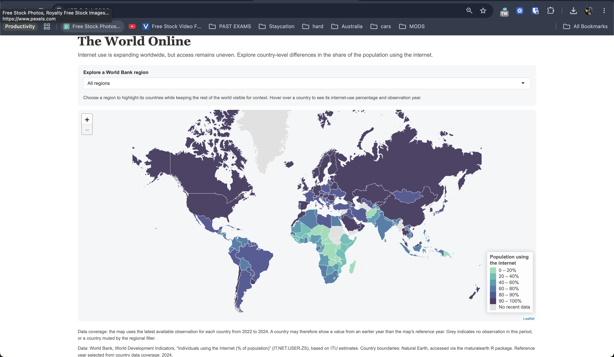

# Module 9: Make It Interactive!

*Published 27 October 2026*

## 1. Ideation
I was both excited but nervous for this module as the initial thought of incorporating interactivity when I’ve mainly worked with static visualisations is daunting. However, this project developed my understanding of how interactivity can improve a data visualisation by allowing users to explore information rather than simply view a static result. I decided to reuse the world internet-use dataset from Module 8 instead of starting from scratch. The original map already communicated an important issue: internet access remains uneven across countries, particularly between more developed regions and parts of Sub-Saharan Africa. Reusing this dataset allowed me to build on my previous work while focusing on a new learning objective: designing meaningful interactivity.   

## 2. Creation process

My first priority was deciding which interactive features would genuinely benefit the user. I chose a world map because the spatial distribution of internet access is central to understanding the digital divide. Using Shiny and Leaflet, I introduced hover tooltips displaying each country's internet-use percentage and observation year. I also added a World Bank region selector that highlights countries within the selected region while keeping the rest of the world visible for geographical context. This was an intentional decision because removing other countries would make regional comparisons more difficult. The interaction encourages users to investigate differences independently rather than relying entirely on my interpretation. 
Several design decisions were carried forward and refined from Module 8. I retained the blue-purple colour palette from the original map to maintain visual consistency, while using graduated colours to distinguish different levels of internet adoption. Grey represents countries without recent data, although it also indicates countries muted by the regional filter. I recognised that these meanings could potentially confuse users, so I added explanatory text beneath the map. I also chose to remove background map tiles, keeping the focus on country-level data and reducing unnecessary visual detail. The serif heading, restrained typography and light-grey interface panels were intended to create a clean, publication-ready appearance. 
An important part of the development process involved handling data quality rather than focusing exclusively on appearance. I used country codes to match the World Bank data with Natural Earth geographical boundaries. I also selected the latest year with at least 80% country coverage and allowed each country to display its latest observation within the preceding two years. This improved coverage but introduced an important limitation: countries on the same map may represent different observation years. Displaying the observation year in each tooltip and explaining the approach beneath the map helps users interpret these differences more accurately. 

## Interactive internet choropleth map
 

Looking back, I believe the final design successfully balances simplicity, functionality and analytical purpose. The regional filter and hover tooltips provide meaningful opportunities for exploration without overwhelming the interface with controls. However, the map could be improved by providing a more explicit distinction between missing data and countries outside the selected region. It also measures internet usage rather than affordability, connection quality or digital literacy, so it cannot represent every dimension of the digital divide. A more nuanced approach I could take in the future is by also considering the disparity between internet affordability between countries. I believe this could reveal and explain if there are any disproportionate internet access between countries due to price differences—which isn’t an insight this current project could reveal.     

## Reflection

Overall, this project strengthened my ability to reuse existing work strategically, integrate spatial data from different sources and make deliberate design decisions. Most importantly, I learned that effective interactivity is not about adding as many features as possible, but about helping users understand the data more clearly while remaining aware of its limitations. 
