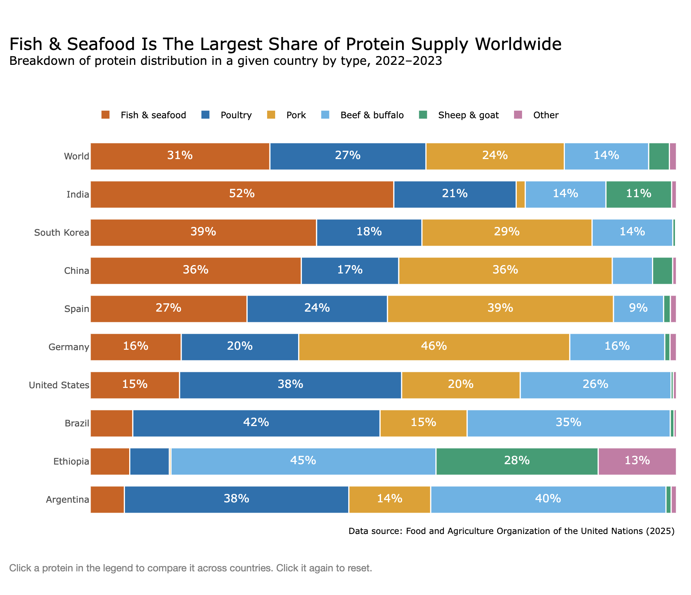
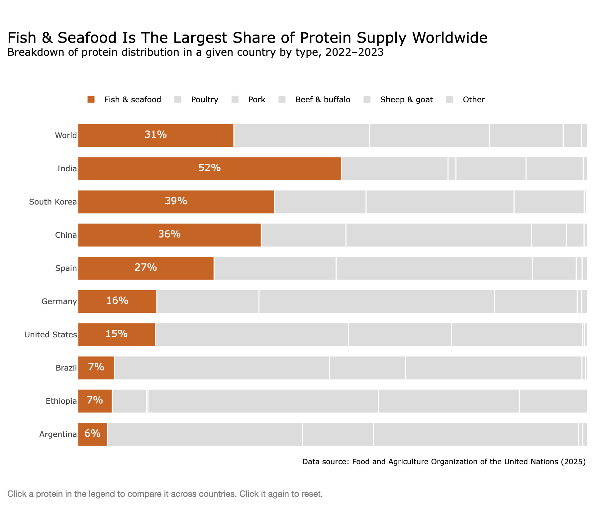

# Module 9: Make It Interactive!

*Published 27 October 2026*

## 1. Ideation
For module 9’s Multiplot It! Exercise, initially I had a few ideas on what approach this assignment could take. I wanted to adapt a static visualisation from OurWorldInData. I had a few good candidates for that, such as “Day of the year with peak cherry tree blossom in Kyoto, Japan” which is an interesting one because I wanted to see if historically Japan’s cherry trees declined or increased (it declined), a good interactivity to add would be a time series chart with hover info. Another one was “Number of people living in the world's largest cities”, a line graph with 9 of the world's most populated cities, where a similar approach of adding a time series would suffice. But I wanted to save the time series interactivity option for module 10, where I had an idea of adding it to a multiplot facet between two economic indicators. I finally landed on an idea I liked with adding interactivity to a static visualisation I made in week 5, the meat chart.   

## 2. Creation process

My first priority when adding interactivity to this static visualisation is deciding which interactive feature would most benefit the audience and enhance their cognitive processing ability. As this is a stacked bar chart with many bars, it would be difficult to manually compare the percentages between countries for each protein option. As a result, I wanted to add a clickable legend which highlights 1 protein option when clicked and mutes the rest, lining them up on the left side from order of largest to smallest so the audience can have an easier time interpreting results for each respective protein. Additionally, I added hoverable info when the cursor of the audience hovers over a stacked bar’s segment, providing information for the smaller segments that don’t meet the 8% requirement to have their percentage shown due to space restrictions—something the original visualisation couldn’t do being static.  

Not only were interactive features added but several design decisions were carried forward and refined from Module 8. I also included a more descriptive title that shows the important finding of this visualisation, naming it “Fish & Seafood Is The Largest Share of Protein Supply Worldwide”, giving the audience what to expect before they begin scanning. I’ve added a colour-blind friendly colour palette using the build-in Okabe Ito palette in R, to make the visualisation more accessible to those with deuteranopia and protanopia, following the ethical data communication principles I’ve learnt from this course. Inside the visualisation itself, I’ve made some technical changes from the original, such as changing the protein order to not start with Poultry, replacing it with Fish & Seafood as that was the one with the largest supply worldwide, communicating the intended message better.  

## Interactive protein app
 
 

This is a screenshot of the native Shiny URL on my computer, the embedded link is: https://km9zqt-norinn-keo.shinyapps.io/protein_app/     

## Reflection

Upon reflecting, while I haven’t used or done anything impressive with the data, mainly just using plotly for two interactive features and shiny for publishing and exporting it as a workable URL link, I believe the final visualisation was still effective in presenting the intended message. The final design balances simplicity with functionality. The clickable legend provides convenience for the audience to explore the different protein options and how it distributes from country to country without having to do mental maths. The hover info allows for smaller segments to still be seen. If I could improve this project, I could’ve added more info on the hoverable points as it currently shows only Country Name and Percentage of the specific protein, I think including population or gdp per capita could explain why some countries eat a certain protein more often.  

Overall, I believe I was able to reuse my existing work strategically, through purposeful integration of interactive features and deliberate design choices. I don’t think I need to include as many features as possible to create a meaningful interactive visualisation, the message was clear and the features I did choose provided all the necessary help to do so.  
